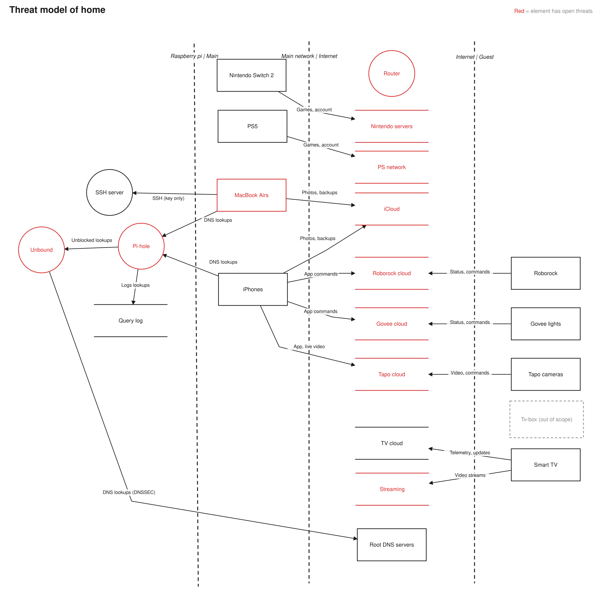

# Home network security lab

Hands-on home network security lab: hardening and threat modelling, with control mapping to ISO 27001 and CIS Controls planned.

A learning project towards a career in technology risk and IT audit.

**Status: work in progress.** The threat model covers all main areas and will be extended as the network changes.

## Start here

*Diagram generated from model file. Red marks elements with open threats.*

The threat model itself is in `docs/threat-model/` (JSON file, made with OWASP Threat Dragon version 1.6.1).

## Scope

- A Raspberry Pi 5 running network-wide DNS filtering and a local recursive DNS resolver with DNSSEC
- Key-only SSH access, with password and root login disabled
- A separate guest network for smart devices (lights, robot vacuum, cameras, TV), with isolation tested
- A threat model covering the main network, the internet and the guest network, including game consoles, phones and cloud accounts

## Repository structure

| Path | Content |
|---|---|
| `docs/threat-model/` | Threat model (OWASP Threat Dragon) |

**Planned:** a project log (what I did, problems, solution, test, lessons) and a mapping of findings to ISO 27001 Annex A and CIS Controls. Files are added as the work progresses.

## Approach

1. Build and harden the setup step by step
2. Test every change, for example that the guest network cannot reach the Pi
3. Record threats and risks in the threat model
4. Map the controls to ISO 27001 Annex A and CIS Controls (mapping to be verified against the standards)

## Notes

No credentials, keys or backups are stored here. Identifying details such as addresses, provider and device names are removed before publication.
